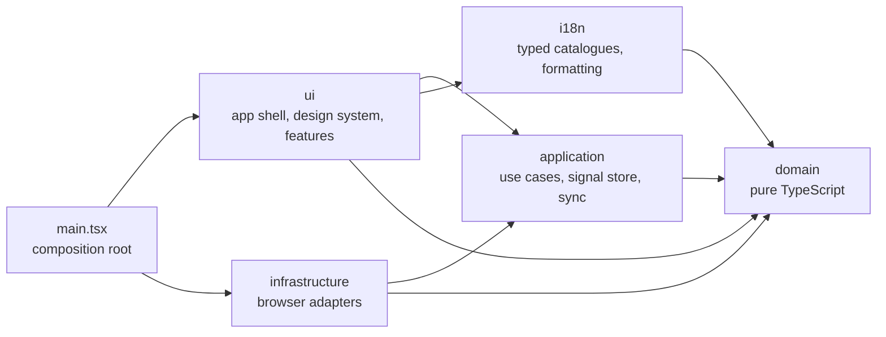
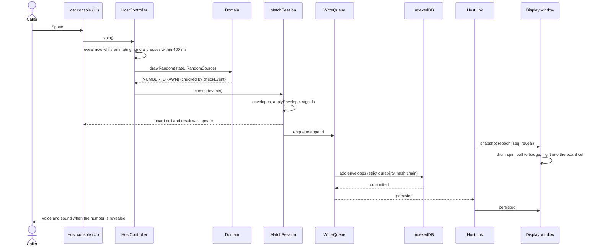
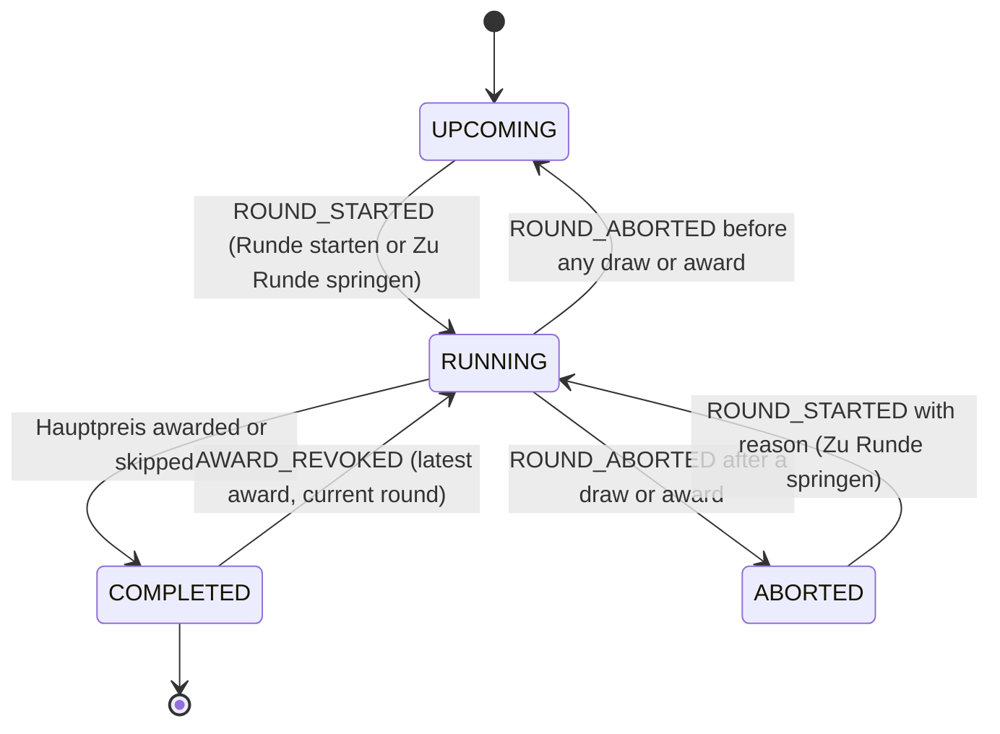
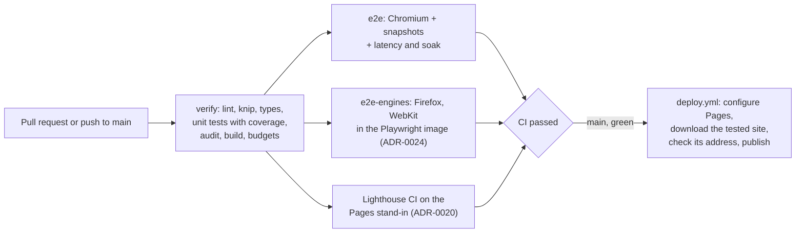

# Architecture

Lottomatch Live is a static single-page app (Preact, `@preact/signals`, TypeScript) served from
GitHub Pages and run offline from a service worker. One laptop runs the host console
(Spielleitung) and, in a second window of the same browser, the audience display (Anzeige).

## Layers

| Layer                | Contents                                                                                                                                                                                                                                        | May import                           |
| -------------------- | ----------------------------------------------------------------------------------------------------------------------------------------------------------------------------------------------------------------------------------------------- | ------------------------------------ |
| `src/domain`         | Types, commands, `checkEvent`, reducer and `replay`, pool derivation, Stechen, RNG mapping, settings and prize validation, CHF and number parsing, canonical JSON                                                                               | nothing (no packages)                |
| `src/application`    | `AppStore`, `MatchSession` (commit pipeline), `WriteQueue`, `HostController`, reveal and overlay controllers, `HostLink`, `DisplayLink`, event administration, PIN, backup export and import, migrations, Valibot schemas, selectors, readiness | domain, `@preact/signals`, `valibot` |
| `src/infrastructure` | IndexedDB stores and hash chain, memory stores, BroadcastChannel and `storage` transports, Web Locks, Wake Lock, Web Speech, Web Audio, image pipeline, CSV codec, screen and file helpers, service-worker registration, diagnostics            | application, domain                  |
| `src/ui`             | App shell (router, header, banners, error boundary, recovery screen, PIN gate, lazy routes), design system (tokens, `BadgeRing`, buttons, surfaces, dialog, toasts, fields), feature pages                                                      | application, domain, i18n            |
| `src/i18n`           | `de-CH` (default) and `en` catalogues with typed keys, Swiss formatting (CHF, `dd.MM.yyyy`, Europe/Zurich)                                                                                                                                      | domain types                         |

The dependency rule is enforced by ESLint (`no-restricted-imports` per directory in
`eslint.config.js`); `Math.random` and `dangerouslySetInnerHTML` are banned by lint rules.

## Ports

The application talks to the browser only through ports (`src/application/ports.ts`,
`src/application/platform.ts`), created once in `src/infrastructure/create-platform.ts`. Tests use
deterministic fakes (`src/test/test-platform.tsx`).

| Port             | Purpose                                        | Browser adapter                                      |
| ---------------- | ---------------------------------------------- | ---------------------------------------------------- |
| `RandomSource`   | uint32 values for draws and Stechen            | `crypto.getRandomValues` (buffered)                  |
| `Clock`          | UTC ISO timestamps, monotonic milliseconds     | `Date`, `performance.now`                            |
| `IdGenerator`    | identifiers                                    | `crypto.randomUUID`                                  |
| `EventStore`     | append-only log, redaction, chain verification | IndexedDB `log` store                                |
| `DocumentStore`  | events, prize catalogues, device metadata      | IndexedDB `matches`, `catalogues`, `meta`            |
| `ImageStore`     | prize images as blobs                          | IndexedDB `images`                                   |
| `SyncTransport`  | host ↔ display messages                        | BroadcastChannel, `storage` fallback                 |
| `HostLock`       | one controlling window                         | Web Locks API                                        |
| `WakeLock`       | keep the screen on                             | Screen Wake Lock API                                 |
| `Announcer`      | spoken numbers                                 | Web Speech API                                       |
| `SoundPlayer`    | synthesised cues                               | Web Audio API                                        |
| `ImageProcessor` | prize image pipeline                           | `createImageBitmap`, canvas                          |
| `CsvCodec`       | Excel de-CH CSV                                | Papa Parse (lazy)                                    |
| `StorageInfo`    | persistence request and usage                  | `navigator.storage`                                  |
| `ScreenControl`  | display window, fullscreen, downloads          | `window.open`, Window Management API, Fullscreen API |
| `CryptoPort`     | SHA-256, PBKDF2, random hex                    | Web Crypto                                           |
| `BinaryCodec`    | base64 for images in exports                   | `Blob`, `btoa`, `atob`                               |
| `Maintenance`    | raw dump and wipe for the recovery screen      | IndexedDB                                            |
| `Diagnostics`    | local error ring buffer                        | localStorage (200 entries)                           |

## Domain and state

The game is event-sourced. Every change is a `LogEvent` (ADR-0004) wrapped in an envelope with a
per-event `seq`. `checkEvent(state, event)` is the single source of truth for the invariants
I1–I7; commands build events and validate them through it, `replay` validates a stored log the
same way. `applyEnvelope` is a pure fold; `GameState` holds the phase, the current round and one
`RoundState` per touched round (draws of the current run, four prize outcomes, timestamps).
The active pool is derived: the round's draws, or only the active prize's draws in per-prize board
mode.

## Commit pipeline

1. A host action (`HostController`) runs a domain command, which returns
   `Result<LogEvent[], DomainError>`; expected errors are values, never exceptions.
2. `MatchSession.commit` refuses in read-only windows, wraps the events in envelopes and applies
   them to the signal state in one `batch`. Only the changed board cells re-render.
3. `HostLink` publishes a new display snapshot from a signal effect, immediately.
4. The `WriteQueue` appends the envelopes to IndexedDB in order (`add`, `durability: 'strict'`,
   hash chain computed in the adapter). Failures are retried with backoff and shown with an
   export button; a `ConstraintError` stops all writes (another window wrote).
5. After the durable write the host broadcasts `persisted`; read-only windows reload from storage.

Settings and the prize catalogue are versioned documents written through the same queue; once the
first round has started, changes also append `SETTINGS_CHANGED` or `PRIZES_CHANGED`.

## Round lifecycle

The event phase moves from `READY` to `ROUND_RUNNING` and `BETWEEN_ROUNDS`, and to `COMPLETED`
only through "Anlass abschliessen" (ADR-0008).

## Sync protocol

Host and display exchange Valibot-validated messages (ADR-0010): `snapshot`, `hello`,
`display-alive`, `persisted`, `takeover-request`, `takeover-ready` and `reload`. Snapshots are
compact (round ring, active prize, progress, pool numbers, latest draw, reveal, overlay, theme,
animation, locale) and ordered by `(epoch, seq)`; the display ignores older ones and, with no host,
renders the persisted state. Exactly one window controls the event through the Web Locks API;
others open read-only with "Steuerung übernehmen".

The draw result is fixed when the key is pressed. The reveal is cosmetic: the snapshot carries the
reveal key, its duration (Aus 0, Kurz 0.8 s, Normal 1.8 s, Spannend 3 s) and an `instant` flag set
by a second press. Spin presses within 400 ms never draw twice; during the animation and its
750 ms settle time a press only reveals. Manual entries are not throttled: each is a typed number,
and the domain rejects a number already drawn.

## Persistence layout

Database `lottomatch-live`, version 1 (ADR-0016):

| Store        | Key              | Content                                                                                          |
| ------------ | ---------------- | ------------------------------------------------------------------------------------------------ |
| `matches`    | `id`             | Event document: kind (real or Übung), settings, settings version, archive flag, last backup time |
| `catalogues` | `matchId`        | Versioned prize catalogue of one event                                                           |
| `log`        | `[matchId, seq]` | Envelopes with `prevHash` and `hash`                                                             |
| `images`     | `id`             | Prize images (WebP or JPEG, ≤ 1280 px, ≤ 400 KB)                                                 |
| `meta`       | `key`            | `preferences`, `activeMatchId`, `pin` (salted PBKDF2 hash), `hostEpoch`                          |

Everything read from storage, imported files and channel messages is validated with Valibot;
stored envelopes are migrated (ADR-0007) and replayed through `checkEvent`. A failure opens the
recovery screen (raw export, type-to-confirm reset) instead of a blank page.

## PWA and offline

`vite-plugin-pwa` generates a Workbox service worker with `registerType: 'prompt'`. It precaches
every built asset (JavaScript, CSS, HTML, fonts, images, prepared event files, manifest) except the
two large 512 px icons and `404.html`, with `index.html` as navigation fallback. Updates install in
the background and wait: "Update bereit" appears only on the host console and only between rounds;
applying it tells displays to reload and activates the new worker. Content-hashed asset names plus
the precache give fast repeat visits despite Pages' short cache lifetimes (C7). The worker is
registered once the booted content has been painted, so its download never competes with the
first screen (ADR-0019).

## Security

- Content-Security-Policy and `referrer: no-referrer` as `<meta>` elements in production builds;
  no inline scripts or styles (Preact sets styles through the CSSOM), no `eval`.
- No requests to third parties; fonts, icons and the logo are self-hosted.
- SVG uploads are rejected by content sniffing; images are re-encoded, which strips metadata.
- CSV exports guard against formula injection; imports remove the guard again.
- The PIN is a salted PBKDF2-SHA-256 hash (210’000 iterations) and is documented as protection
  against accidents only.

## Error handling

- Route-level error boundaries keep the shell alive and reset on navigation.
- Global `error` and `unhandledrejection` handlers record into the local diagnostics ring buffer
  and show a toast; the buffer is exportable from Einstellungen → Über.
- Persistent banners cover a read-only window, storage failures (with "Jetzt exportieren"),
  memory-only storage and a waiting update.
- A failed lazy page load offers a reload; corrupt stored data opens the recovery screen.

## Delivery

The site is built once, in CI, and the deploy workflow publishes exactly that artifact. Its base
path and absolute URL come from repository variables with project-site defaults (README); the
deploy job refuses a build made for another address than the one Pages reports.
